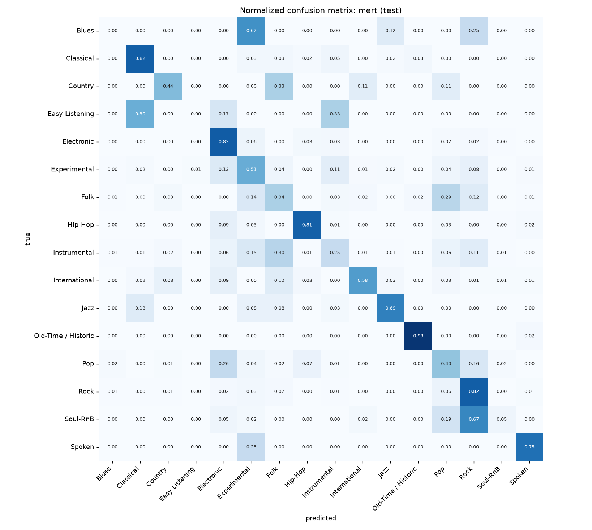

# Results

Official FMA test split, track level (window probabilities averaged).

| Run | Model | Tracks | Top-1 acc | Top-3 acc | Macro-F1 | Weighted-F1 |
|---|---|---|---|---|---|---|
| mert | mert_head | 2572 | 0.682 | 0.846 | **0.493** | 0.680 |
| cnn | cnn | 2572 | 0.671 | 0.845 | **0.460** | 0.651 |

## Per-genre F1

| Genre | Support | cnn | mert |
|---|---|---|---|
| Blues | 8 | 0.000 | 0.000 |
| Classical | 62 | 0.767 | 0.767 |
| Country | 18 | 0.256 | 0.333 |
| Easy Listening | 6 | 0.000 | 0.000 |
| Electronic | 632 | 0.797 | 0.824 |
| Experimental | 225 | 0.419 | 0.484 |
| Folk | 152 | 0.359 | 0.333 |
| Hip-Hop | 220 | 0.765 | 0.834 |
| Instrumental | 174 | 0.337 | 0.315 |
| International | 102 | 0.601 | 0.678 |
| Jazz | 39 | 0.540 | 0.692 |
| Old-Time / Historic | 51 | 0.944 | 0.943 |
| Pop | 119 | 0.298 | 0.315 |
| Rock | 710 | 0.806 | 0.826 |
| Soul-RnB | 42 | 0.000 | 0.075 |
| Spoken | 12 | 0.476 | 0.462 |

## cnn: most frequent confusions

| True | Predicted as | Rate | Count |
|---|---|---|---|
| Soul-RnB | Rock | 0.67 | 28 |
| Blues | Rock | 0.62 | 5 |
| Easy Listening | Instrumental | 0.50 | 3 |
| Country | Rock | 0.33 | 6 |
| Easy Listening | Classical | 0.33 | 2 |
| Instrumental | Folk | 0.32 | 56 |
| Folk | Rock | 0.32 | 48 |
| Pop | Electronic | 0.25 | 30 |

## mert: most frequent confusions

| True | Predicted as | Rate | Count |
|---|---|---|---|
| Soul-RnB | Rock | 0.67 | 28 |
| Blues | Experimental | 0.62 | 5 |
| Easy Listening | Classical | 0.50 | 3 |
| Country | Folk | 0.33 | 6 |
| Easy Listening | Instrumental | 0.33 | 2 |
| Instrumental | Folk | 0.30 | 52 |
| Folk | Pop | 0.29 | 44 |
| Pop | Electronic | 0.26 | 31 |

## Error analysis

**Headline.** MERT (frozen embeddings + small head) beats the from-scratch CNN, but only modestly:
macro-F1 0.493 vs 0.460, accuracy 0.682 vs 0.671, top-3 accuracy essentially equal (0.846 vs 0.845).
Gains are concentrated in Jazz (+0.15 F1), Hip-Hop (+0.07), International (+0.08), Experimental (+0.07)
and Country (+0.08). Both models are strong on Old-Time/Historic (0.94), Electronic, Rock, Hip-Hop and
Classical (0.77-0.83), where the sound is distinctive and training data is plentiful.

**Caveats on the comparison.** One seed per model and no confidence intervals. The rare genres have 6-42
test tracks, so a few tracks move their F1 a lot, and a 0.033 macro-F1 gap is not clearly outside that
noise. Validation macro-F1 for MERT (0.544) is higher than test (0.493): the best epoch was picked on a
noisy validation metric, so validation scores are optimistic. Test numbers are the ones to quote.
MERT's head also overfits (train acc ~0.79 vs ~0.71 val).

**Where the models fail, and likely reasons** (the causes are hypotheses; they were not tested):

1. **Rare genres are essentially not learned.** Blues (8 test tracks), Easy Listening (6) and Soul-RnB
   (42) score 0.00-0.08 F1 for both models. Training counts are 58, 13 and 94 tracks vs 5,681 for Rock,
   so even 1/sqrt(frequency) class weights are not enough. Soul-RnB is sent to Rock in 28 of 42 cases
   (both models), Blues to Rock (CNN) or Experimental (MERT), and Easy Listening to Classical or
   Instrumental. These genres also share instrumentation with the majority classes, and FMA's top-level
   genre is the artist's own tag, which is noisy.
2. **Instrumental, Folk, Pop and Experimental overlap with everything.** Instrumental is mistaken for Folk
   in ~30% of cases (52-56 tracks) and Folk for Rock (CNN) or Pop (MERT) in ~30% of cases. Pop goes to
   Electronic (~25%) and to Hip-Hop/Rock. These labels describe context and production rather than a
   distinctive sound, which matches the brief's expectation that Experimental, Pop and Electronic overlap.
3. **The CNN confuses Folk/Country with Rock** (guitar-driven timbre); MERT moves some of that to Folk/Pop,
   which is consistent with pretrained embeddings capturing instrumentation better.

**MERT layer weights.** The learned layer mixture peaks in the middle of the network (layer 6: 0.33;
layers 5-7 together: 0.65) and is small for the first and last layers, so mid-level layers carry most of
the genre information in this setup.

**What would likely help (not done):** a weighted sampler or stronger class weights for the three
smallest genres; merging or dropping genres with fewer than ~100 training tracks; several seeds and
bootstrap confidence intervals; fine-tuning MERT or AST (planned for days 3-4).
