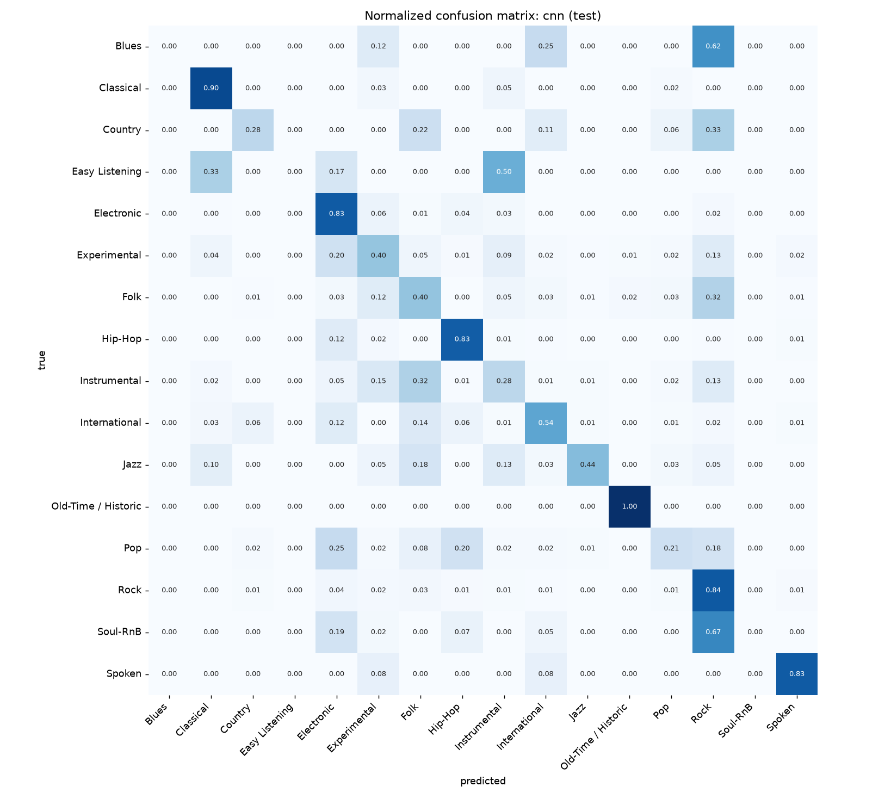
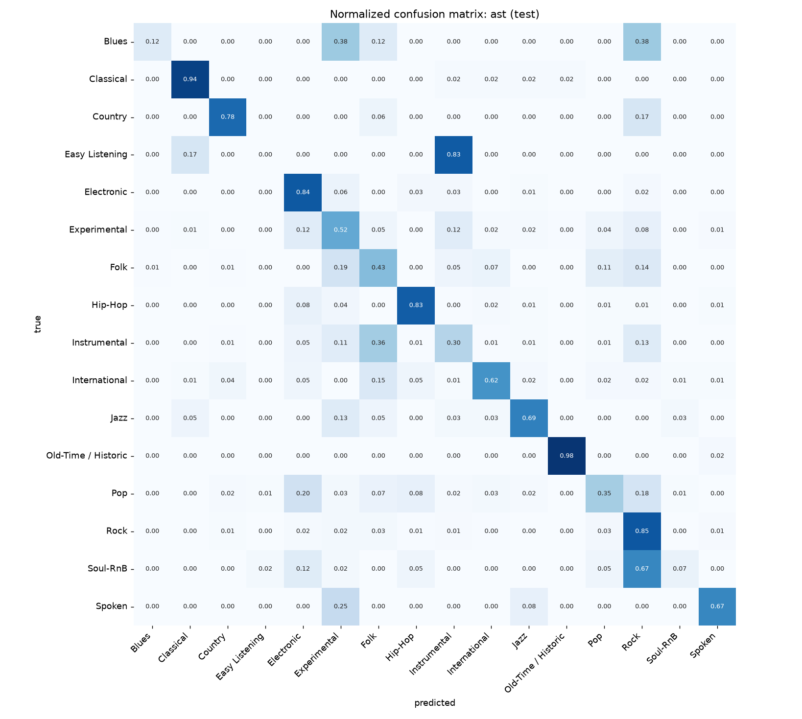

# Results

Official FMA test split, track level (window probabilities averaged).

| Run | Model | Tracks | Top-1 acc | Top-3 acc | Macro-F1 | Weighted-F1 |
|---|---|---|---|---|---|---|
| mert | mert_head | 2572 | 0.682 | 0.846 | **0.493** | 0.680 |
| cnn | cnn | 2572 | 0.671 | 0.845 | **0.460** | 0.651 |

## Per-genre F1

| Genre | Support | cnn | mert |
|---|---|---|---|
| Blues | 8 | 0.000 | 0.000 |
| Classical | 62 | 0.767 | 0.767 |
| Country | 18 | 0.256 | 0.333 |
| Easy Listening | 6 | 0.000 | 0.000 |
| Electronic | 632 | 0.797 | 0.824 |
| Experimental | 225 | 0.419 | 0.484 |
| Folk | 152 | 0.359 | 0.333 |
| Hip-Hop | 220 | 0.765 | 0.834 |
| Instrumental | 174 | 0.337 | 0.315 |
| International | 102 | 0.601 | 0.678 |
| Jazz | 39 | 0.540 | 0.692 |
| Old-Time / Historic | 51 | 0.944 | 0.943 |
| Pop | 119 | 0.298 | 0.315 |
| Rock | 710 | 0.806 | 0.826 |
| Soul-RnB | 42 | 0.000 | 0.075 |
| Spoken | 12 | 0.476 | 0.462 |

## cnn: most frequent confusions

| True | Predicted as | Rate | Count |
|---|---|---|---|
| Soul-RnB | Rock | 0.67 | 28 |
| Blues | Rock | 0.62 | 5 |
| Easy Listening | Instrumental | 0.50 | 3 |
| Country | Rock | 0.33 | 6 |
| Easy Listening | Classical | 0.33 | 2 |
| Instrumental | Folk | 0.32 | 56 |
| Folk | Rock | 0.32 | 48 |
| Pop | Electronic | 0.25 | 30 |

## mert: most frequent confusions

| True | Predicted as | Rate | Count |
|---|---|---|---|
| Soul-RnB | Rock | 0.67 | 28 |
| Blues | Experimental | 0.62 | 5 |
| Easy Listening | Classical | 0.50 | 3 |
| Country | Folk | 0.33 | 6 |
| Easy Listening | Instrumental | 0.33 | 2 |
| Instrumental | Folk | 0.30 | 52 |
| Folk | Pop | 0.29 | 44 |
| Pop | Electronic | 0.26 | 31 |

## Model B: AST and the final comparison

AST (fine-tuned AudioSet checkpoint) was trained in several setups and evaluated once on test.
Seed means for CNN (4), MERT (5) and AST frozen (3); the other AST rows are single runs. Full tables, paired bootstrap intervals and
per-genre scores: [imbalance_and_uncertainty.md](imbalance_and_uncertainty.md).

| Model | Runs | Top-1 acc | Macro-F1 | 95% CI of macro-F1 (test tracks) |
|---|---|---|---|---|
| CNN | 4 seeds | 0.673 ± 0.002 | 0.465 ± 0.005 | [0.441, 0.485] |
| MERT + head | 5 seeds | 0.683 ± 0.004 | 0.496 ± 0.004 | [0.471, 0.517] |
| AST, 8 layers frozen, 3 epochs | 3 seeds | 0.705 ± 0.003 | 0.533 ± 0.004 | [0.503, 0.561] |
| AST, full fine-tune, 3 epochs | 1 run | 0.702 | 0.531 | [0.499, 0.559] |
| AST, 8 layers frozen, 10 epochs (early stop, best epoch 6) | 1 run | 0.682 | 0.510 | [0.482, 0.533] |

- AST (frozen, 3 seeds pooled) beats MERT by +0.038 (95% CI 0.012 to 0.064) and the CNN by +0.068 (0.041 to 0.096).
  Full fine-tune − frozen: −0.003 (−0.017 to 0.012), i.e. no measurable difference.
- Seed variance: the three frozen runs scored 0.538 / 0.531 / 0.531, a spread (0.004) as small as the CNN's and MERT's,
  so the AST lead over MERT is not a seed accident. This closes the earlier "single run" caveat.
- Longer training: the 10-epoch run reached its best validation macro-F1 (0.559) at epoch 6, then overfit (train acc 0.86 vs
  val 0.71); early stopping (patience 4) ended it after epoch 10. Test macro-F1 0.510 is 0.024 lower than the 3-epoch
  recipe (CI −0.046 to −0.002) and only +0.014 over MERT (−0.007 to 0.036, not clearly better). Single run: the safe
  conclusion is that more epochs gave no gain here; the 3-epoch schedule (OneCycle compressed to 3 epochs) works well.
- Where AST gains most over MERT (test F1, frozen setup, seed mean): Country 0.56 vs 0.34, Classical 0.88 vs 0.80, Pop 0.38 vs
  0.28, and it is the only model with a non-zero Blues F1 (0.16; 8 test tracks). Easy Listening stays at 0.00 for every model.
- Caveats: the intervals cover test-set sampling plus seeds only for the pooled row; the full fine-tune and 10-epoch rows are
  single runs, and validation numbers (about 0.57) are optimistic relative to test, as for the other models.

## Error analysis

**Headline.** MERT (frozen embeddings + small head) beats the from-scratch CNN, but only modestly:
macro-F1 0.493 vs 0.460, accuracy 0.682 vs 0.671, top-3 accuracy essentially equal (0.846 vs 0.845).
Gains are concentrated in Jazz (+0.15 F1), Hip-Hop (+0.07), International (+0.08), Experimental (+0.07)
and Country (+0.08). Both models are strong on Old-Time/Historic (0.94), Electronic, Rock, Hip-Hop and
Classical (0.77-0.83), where the sound is distinctive and training data is plentiful.

**Caveats on the comparison (updated after the multi-seed runs,
see [imbalance_and_uncertainty.md](imbalance_and_uncertainty.md)).** The tables above are the original single-seed
runs (seed 42). Five MERT seeds give test macro-F1 0.496 ± 0.004 (accuracy 0.683 ± 0.004) and four CNN seeds give
0.465 ± 0.005 (accuracy 0.673 ± 0.002), so seed noise is small for both. A paired bootstrap over the 2,572 test
tracks, on the seed-averaged results, puts the MERT − CNN macro-F1 gap at **+0.031** (95% CI 0.010 to 0.050,
MERT ahead in 100% of 2,000 resamples): the gap is about six times the seed-to-seed spread and its interval
excludes zero. The rare genres have 6-42 test tracks, so their individual F1 scores stay noisy. Validation macro-F1 for MERT (0.542 ± 0.013 over seeds) is higher than test
(0.496): the best epoch and configuration were picked on a noisy validation metric, so validation scores are
optimistic. Test numbers are the ones to quote. MERT's head also overfits (train acc ~0.79 vs ~0.71 val).

**Imbalance fixes did not help.** On validation (5 seeds each) the original recipe (loss weights ∝ 1/sqrt(freq))
scored 0.542 ± 0.013 macro-F1. Class-balanced sampling (sqrt: 0.539 ± 0.009; full: 0.517 ± 0.006), no weighting
(0.496 ± 0.002), full 1/freq weights (0.341 ± 0.006) and post-hoc prior correction (for both MERT and the
CNN) did not beat it; stronger corrections over-predict rare genres and lower macro-F1. Blues and Easy
Listening stay at 0.00 F1 for both models; Soul-RnB reaches 0.18 for MERT (mean of 5 seeds) and 0.04 for the CNN (mean of 4 seeds).

**Where the models fail, and likely reasons.** The explanations below were written first; they are tested in the section after this list.

1. **Rare genres are essentially not learned.** Blues (8 test tracks), Easy Listening (6) and Soul-RnB
   (42) score 0.00-0.08 F1 for both models. Training counts are 58, 13 and 94 tracks vs 5,681 for Rock,
   so even 1/sqrt(frequency) class weights are not enough. Soul-RnB is sent to Rock in 28 of 42 cases
   (both models), Blues to Rock (CNN) or Experimental (MERT), and Easy Listening to Classical or
   Instrumental. These genres also share instrumentation with the majority classes, and FMA's top-level
   genre is the artist's own tag, which is noisy.
2. **Instrumental, Folk, Pop and Experimental overlap with everything.** Instrumental is mistaken for Folk
   in ~30% of cases (52-56 tracks) and Folk for Rock (CNN) or Pop (MERT) in ~30% of cases. Pop goes to
   Electronic (~25%) and to Hip-Hop/Rock. These labels describe context and production rather than a
   distinctive sound, which matches the brief's expectation that Experimental, Pop and Electronic overlap.
3. **The CNN confuses Folk/Country with Rock** (guitar-driven timbre); MERT moves some of that to Folk/Pop,
   which is consistent with pretrained embeddings capturing instrumentation better.

**MERT layer weights.** The learned layer mixture peaks in the middle of the network (layer 6: 0.33;
layers 5-7 together: 0.65) and is small for the first and last layers, so mid-level layers carry most of
the genre information in this setup.

## Tests of these explanations

Details and numbers: [error_analysis_tests.md](error_analysis_tests.md). Summary (each verdict refers only to the
stated criterion; this is descriptive analysis of saved predictions, nothing was tuned on it):

| Explanation | Test | Result |
|---|---|---|
| H1. Fewer training tracks, lower F1 | Spearman correlation of log training count and test F1 over 16 genres | **Supported:** rho 0.58 (MERT), 0.59 (CNN), p < 0.02. Scarcity matters. |
| H2. Errors name another genre the track is also tagged with | Share of errors whose predicted genre is another top-level tag of the track | **Not testable:** every track in FMA-medium has exactly one top-level genre by construction (the subset keeps single-genre tracks), so this cannot support or refute label ambiguity. |
| H3. Rare-genre tracks sit among other genres | 10 nearest training neighbours in MERT embedding space | **Consistent:** Soul-RnB, Blues and Easy Listening tracks have 0-1% same-genre neighbours (Soul-RnB: lift 2.0 over chance, mostly Rock neighbours), compared with 72% for Classical and Hip-Hop. |
| H4. The confused pairs are hard to separate even with enough data | Class-balanced logistic regression on MERT embeddings, AUC on test | **Supported:** Instrumental vs Folk 0.75 (about 1,000 training tracks each), Pop vs Electronic 0.88, Soul-RnB vs Rock 0.67, against 0.998 for the distant control pairs. |
| H5. Both models fail on the same tracks | Overlap of CNN and MERT errors | **Supported:** the models make mostly the same mistakes: 79% of the CNN's errors are also MERT errors and 81% of MERT's errors are also CNN errors, and on shared errors they predict the same wrong genre 70% of the time (13% expected by chance). |

Reading the tests together: scarcity is part of the story (H1), but not all of it. Instrumental vs Folk is poorly
separable (AUC 0.75) although both have about 1,000 training tracks, so genuine overlap between these labels exists
independently of data quantity (H4). The CNN and MERT also fail on mostly the same tracks and, when both are wrong,
predict the same wrong genre 70% of the time against 13% expected by chance (H5), which points to properties of the
tracks or labels more than to model-specific weaknesses. What these tests cannot separate is noisy labels from
real acoustic overlap, and the direct label-ambiguity test (H2) is impossible on this subset. One side effect: the
single-genre selection probably makes FMA-medium labels cleaner than the full collection, so real-world ambiguity
is likely understated here.

**What would likely help (not done):** merging or dropping genres with fewer than ~100 training tracks, or
collecting more data for them, since loss weighting, sampling and prior correction did not help (see above);
using FMA's finer-grained sub-genre labels; fine-tuning MERT or AST.
